<div align="center">


# PatiPaket

### Mama bitmeden kapında.

Kedi, köpek ve kuşlar için **mama, yem, kum ve sarf malzemelerini abonelikle satan**
e-ticaret platformu: web sitesi, **iOS ve Android** uygulaması, API ve mağaza yönetim paneli — tek depoda.


<br />

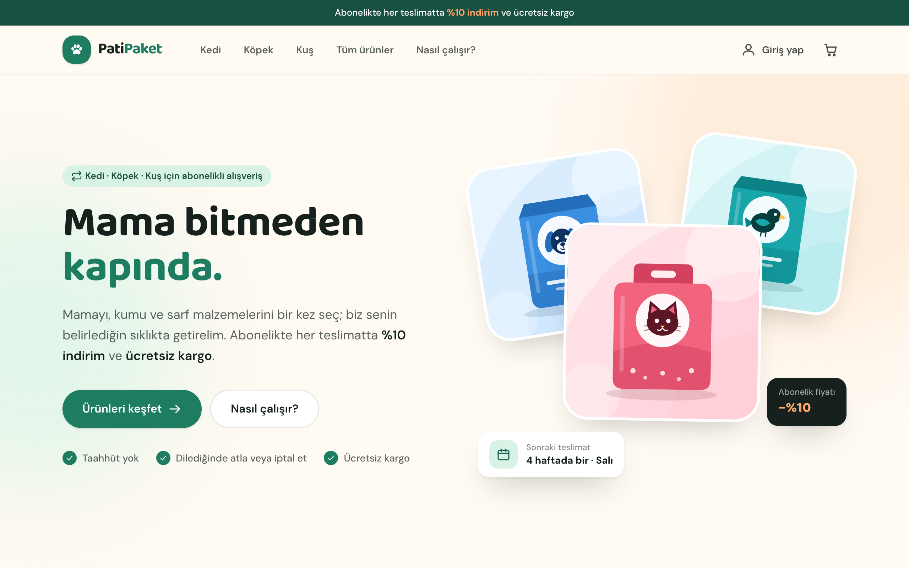

</div>

<br />

<table>
  <tr>
    <td width="20%">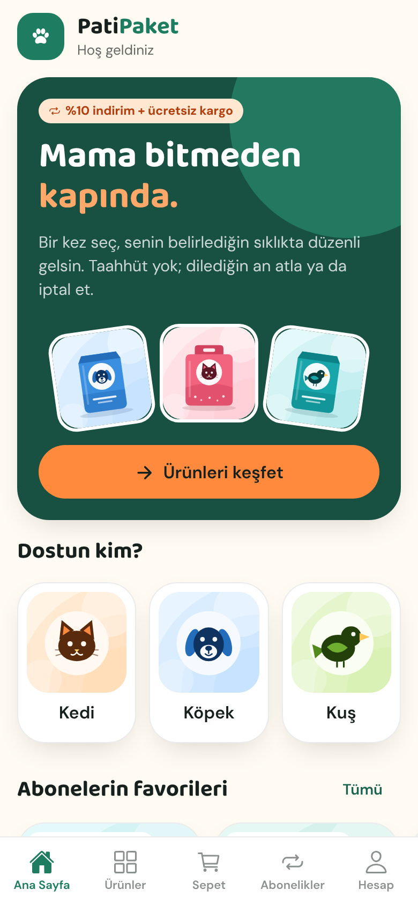</td>
    <td width="20%">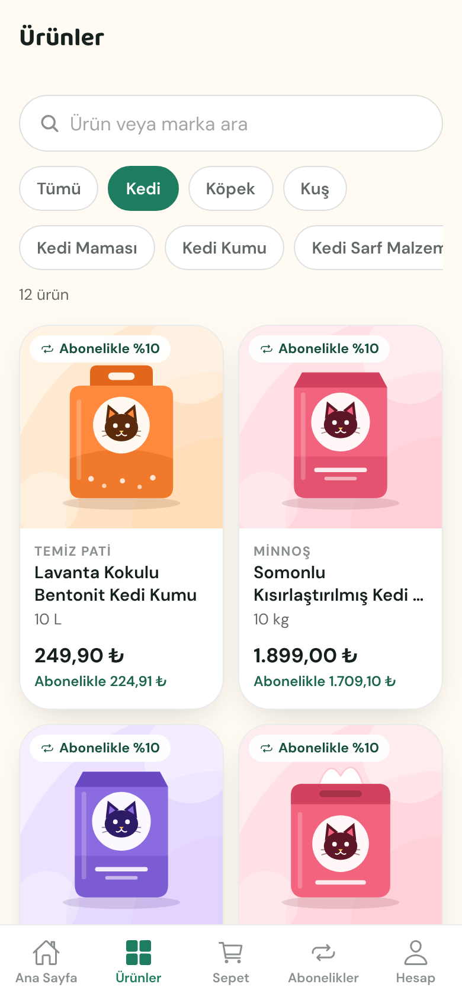</td>
    <td width="20%">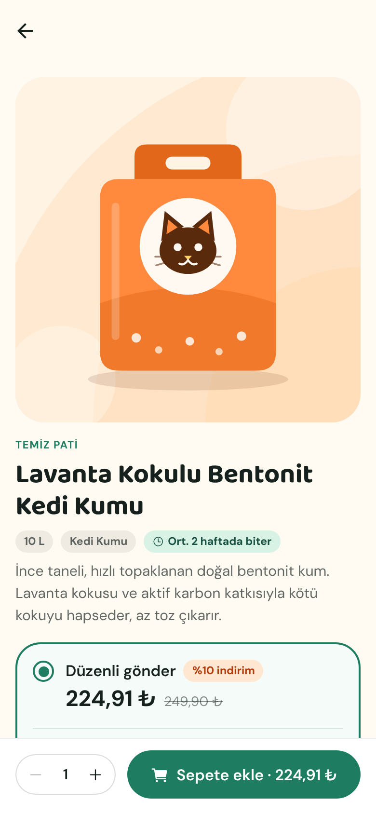</td>
    <td width="20%">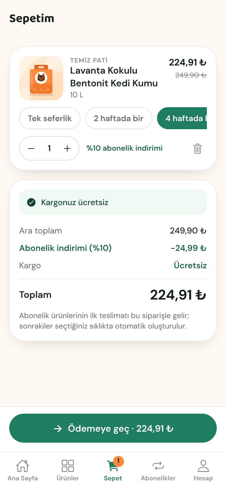</td>
    <td width="20%">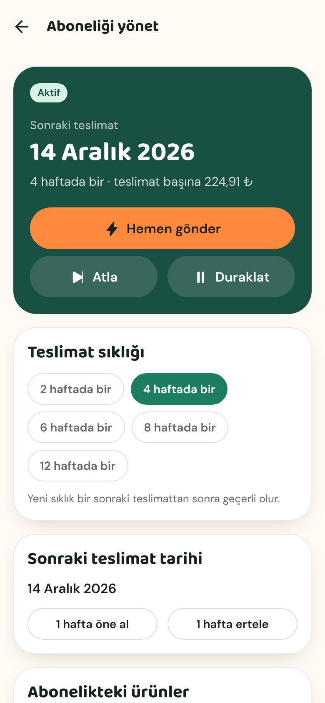</td>
  </tr>
  <tr>
    <td align="center"><sub>Ana sayfa</sub></td>
    <td align="center"><sub>Ürünler</sub></td>
    <td align="center"><sub>Ürün ve sıklık seçimi</sub></td>
    <td align="center"><sub>Sepet</sub></td>
    <td align="center"><sub>Abonelik yönetimi</sub></td>
  </tr>
</table>

## Neler var?

| | |
|---|---|
| **Abonelikle satış** | Her üründe “Düzenli gönder” seçeneği: 2, 4, 6, 8 veya 12 haftada bir teslimat, **%10 indirim** ve **ücretsiz kargo**. Ürün başına “ortalama şu kadar sürede biter” önerisi. |
| **Esnek abonelik yönetimi** | Teslimatı atla, tarihi öne al / ertele, hemen gönder, duraklat, devam ettir, sıklığı, ürün adedini, adresi ve kartı değiştir, tek tıkla iptal et. Taahhüt yok. |
| **Otomatik yenileme** | Günlük görev, günü gelen abonelikler için stok ayırır, kayıtlı karttan tahsil eder, siparişi oluşturur. Ödeme alınamazsa ertesi gün yeniden dener; 3 başarısız denemede aboneliği duraklatır. |
| **Mağaza** | Kedi · köpek · kuş için mama/yem, kum ve sarf malzemeleri; arama, filtre, sıralama; tek seferlik ve abonelik ürünleri aynı sepette. |
| **Hesap** | Siparişler, adresler, kayıtlı kartlar, evcil dost profilleri. |
| **Yönetim paneli** | Ciro ve abonelik özeti, yaklaşan yenilemeler, stoku azalan ürünler, sipariş durumu ve kargo takibi, ürün ekleme/düzenleme. |
| **iOS ve Android** | Web ile aynı API'yi, aynı fiyatlama ve sepet mantığını kullanan yerel uygulama (Expo / React Native). |

<br />

<table>
  <tr>
    <td width="50%">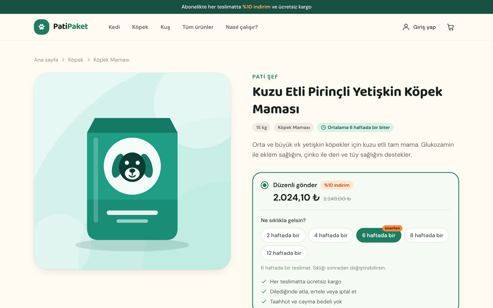</td>
    <td width="50%">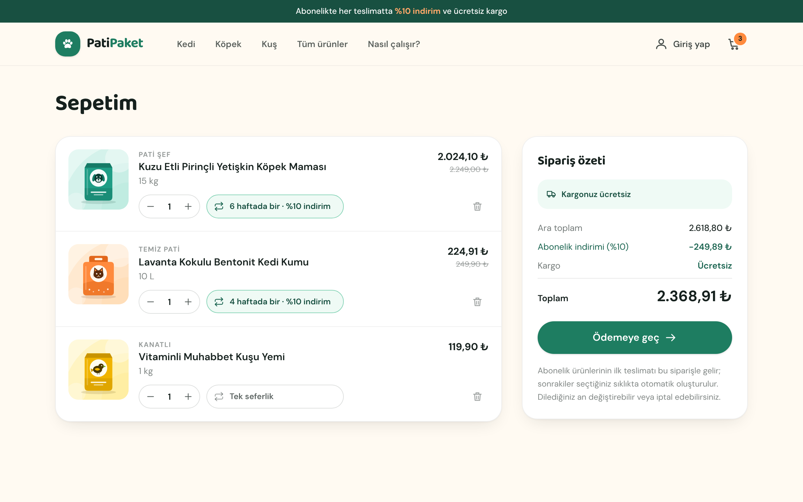</td>
  </tr>
  <tr>
    <td align="center"><sub>Ürün detayı: abonelik ya da tek seferlik</sub></td>
    <td align="center"><sub>Sepet: abonelik indirimi ve ücretsiz kargo</sub></td>
  </tr>
  <tr>
    <td>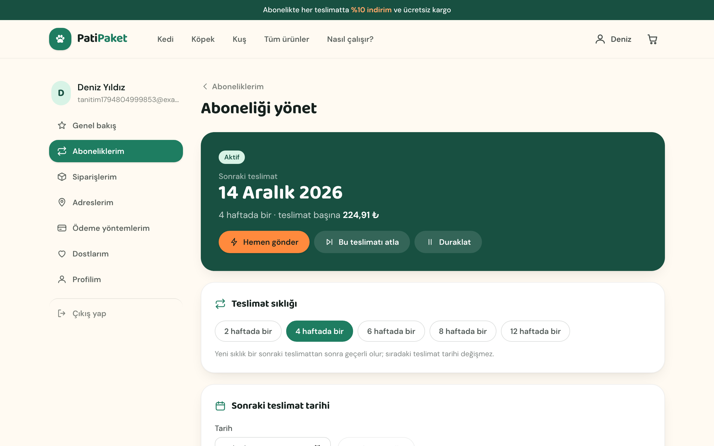</td>
    <td>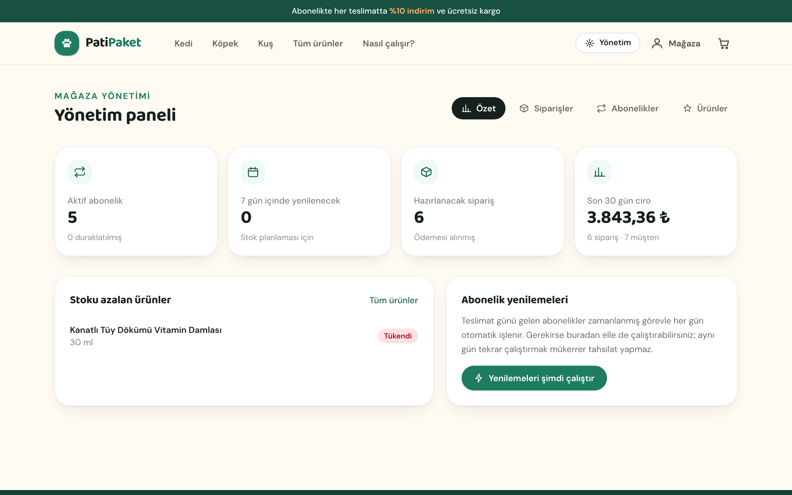</td>
  </tr>
  <tr>
    <td align="center"><sub>Abonelik yönetimi</sub></td>
    <td align="center"><sub>Mağaza yönetim paneli</sub></td>
  </tr>
</table>

## Mimari

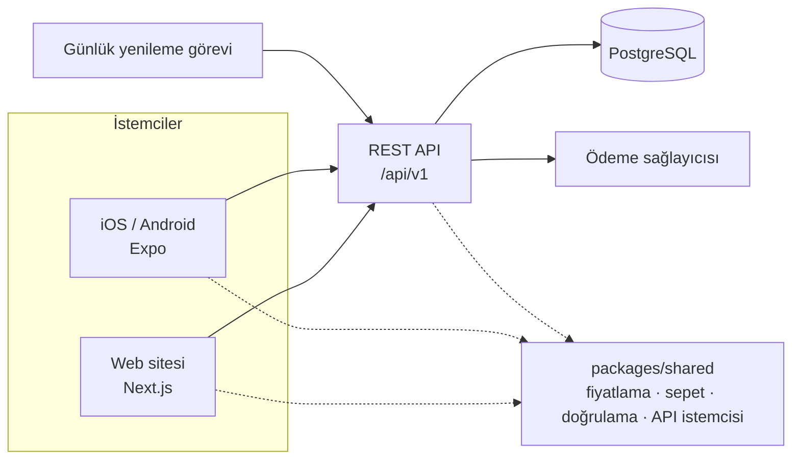

```
apps/
  web/        Next.js 16 — web sitesi, REST API (/api/v1) ve yönetim paneli (/yonetim)
  mobile/     Expo SDK 58 — iOS ve Android uygulaması
packages/
  shared/     Web, mobil ve sunucunun ortak kullandığı kod:
              fiyat hesaplama, sepet mantığı, doğrulama şemaları, API istemcisi, ürün çizimleri
```

Ekranda görünen tutar ile karttan çekilen tutar aynı fonksiyonla (`computeQuote`) hesaplanır;
sunucu, istemcinin gönderdiği fiyatlara hiçbir zaman güvenmez.

## Hızlı başlangıç

Gerekenler: **Node.js 22.13+** ve **Docker** (ya da kendi PostgreSQL 16 kurulumunuz).

```bash
# 1) Bağımlılıklar
npm install

# 2) Veritabanı
docker compose up -d

# 3) Ortam değişkenleri
cp apps/web/.env.example apps/web/.env.local
#    AUTH_SECRET ve CRON_SECRET için rastgele değerler verin:  openssl rand -base64 48

# 4) Tablolar ve örnek ürünler
npm run db:migrate
npm run db:seed

# 5) Web sitesi + API
npm run dev            # http://localhost:3000
```

`db:seed` geliştirme ortamında iki örnek hesap da oluşturur:

| Rol | E-posta | Şifre |
|---|---|---|
| Yönetici | `admin@patipaket.local` | `Admin1234!` |
| Müşteri | `demo@patipaket.local` | `Demo1234!` |

Yönetim paneli: <http://localhost:3000/yonetim>

### Mobil uygulama

```bash
cp apps/mobile/.env.example apps/mobile/.env   # API adresi (EXPO_PUBLIC_API_URL)
npm run dev:mobile                             # Expo geliştirme sunucusu
```

Ardından terminalde `i` (iOS simülatörü), `a` (Android emülatörü) ya da `w` (tarayıcı) tuşuna basın.
Android emülatöründe API adresi `http://10.0.2.2:3000`, gerçek telefonda bilgisayarınızın yerel ağ adresi olmalıdır.

**App Store ve Google Play'e gönderme** ([EAS](https://docs.expo.dev/eas/) ile, Mac gerekmez):

```bash
cd apps/mobile
npx eas-cli@latest build --platform all --profile production
npx eas-cli@latest submit --platform all
```

Göndermeden önce `apps/mobile/app.json` içindeki `bundleIdentifier` / `package` değerlerini kendi
alan adınıza göre, `apps/mobile/eas.json` içindeki `EXPO_PUBLIC_API_URL` değerini canlı site adresinize göre değiştirin.

> Fiziksel ürün satıldığı için ödemeler Apple / Google uygulama içi satın alma sistemiyle değil,
> kendi ödeme sağlayıcınızla alınır.

## Abonelik nasıl çalışır?

1. Müşteri ürünü sıklık seçerek sepete ekler. Ödemede ilk teslimat hemen tahsil edilir.
2. Aynı sıklıktaki ürünler tek abonelikte toplanır ve tek pakette gönderilir.
3. Her gün çalışan görev, teslimat günü gelen abonelikleri işler:

```bash
curl -X POST https://SITENIZ/api/v1/cron/renew-subscriptions \
     -H "Authorization: Bearer $CRON_SECRET"
```

- Vercel'de `apps/web/vercel.json` bu görevi her gün 08:00'de (TSİ) kendiliğinden çağırır.
- Başka bir sunucuda aynı isteği `crontab`, GitHub Actions ya da herhangi bir zamanlayıcıyla atabilirsiniz.
- Aynı gün birden çok kez çağrılması güvenlidir; **mükerrer tahsilat yapılmaz**.
- Stokta olmayan ürün teslimatı bir hafta erteler; reddedilen kart ertesi gün yeniden denenir.

## Ödeme altyapısı

Depo, gerçek para tahsil etmeyen bir **test sağlayıcısıyla** gelir; böylece tüm akış hesap açmadan denenebilir.

| Test kartı | Sonuç |
|---|---|
| `4242 4242 4242 4242` | Onaylanır |
| `4000 0000 0000 0002` | Kart kaydedilir, tahsilat reddedilir |

Gerçek satışa geçmek için `apps/web/src/server/payment/index.ts` içindeki `PaymentProvider`
arayüzünü (kart saklama + jetonla tahsilat) anlaşacağınız kuruluş için uygulayın — iyzico, PayTR, Param, Stripe vb.
Uygulama kart numarasını ve güvenlik kodunu **hiçbir zaman saklamaz**; veritabanında yalnızca
sağlayıcının verdiği jeton, kart markası ve son dört hane tutulur. Canlıda kart formunu sağlayıcının
barındırdığı alanlarla almanız (PCI-DSS) gerekir.

## Testler

```bash
npm test          # fiyatlama, sepet, sipariş ve abonelik servisleri
npm run typecheck # ortak paket + web + mobil
npm run lint
```

Servis testleri gerçek PostgreSQL üzerinde çalışır (`patipaket_test`) ve şu durumları kapsar:
son ürün için yarışan iki sipariş, reddedilen kartta stokun geri verilmesi, aynı gün iki kez çalışan
yenileme görevi, üç başarısız tahsilatta duraklatma, başka kullanıcının aboneliğine erişim.

Her gönderimde GitHub Actions (`.github/workflows/ci.yml`) tip denetimi, lint, testler ve üretim derlemesini çalıştırır.

## Yayına almadan önce

- [ ] **Marka adı:** “PatiPaket” bir çalışma adıdır. `packages/shared/src/constants.ts` içindeki `APP_NAME`
      ile `apps/mobile/app.json` üzerinden değiştirin; marka tescilini kontrol edin.
- [ ] **Ödeme:** Gerçek bir ödeme sağlayıcısı bağlayın (yukarıya bakın).
- [ ] **Yasal metinler:** `/gizlilik` ve `/mesafeli-satis` sayfaları taslak şablondur; hukuk danışmanınızın
      hazırlayacağı metinlerle değiştirin (KVKK, mesafeli satış, ön bilgilendirme).
- [ ] **Bildirimler:** Sipariş onayı ve “ödeme alınamadı” bildirimleri şu an yalnızca sunucu günlüğüne yazılır.
      `apps/web/src/server/notifications.ts` içine bir e-posta / SMS sağlayıcısı bağlayın.
- [ ] **Gizli anahtarlar:** `AUTH_SECRET` ve `CRON_SECRET` için güçlü, rastgele değerler kullanın.
- [ ] **Yönetici hesabı:** `ADMIN_PASSWORD='…' npm run create-admin -- siz@ornek.com "Ad Soyad"`
- [ ] **Ürünler:** Örnek katalogdaki markalar kurgusaldır; kendi ürünlerinizi yönetim panelinden ekleyin.
      Fotoğraf yüklenmeyen ürünlerde otomatik çizim gösterilir.
- [ ] **Deneme sınırı:** Giriş denemesi sınırlayıcısı bellek içidir; birden çok sunucu kopyasıyla
      çalışacaksanız paylaşımlı bir depoya (ör. Redis) taşıyın.

## Teknolojiler

| Katman | Kullanılan |
|---|---|
| Web + API | Next.js 16 (App Router), React 19, Tailwind CSS 4 |
| Mobil | Expo SDK 58, React Native, Expo Router |
| Veritabanı | PostgreSQL 16, Drizzle ORM |
| Ortak | TypeScript, Zod, Zustand |
| Kimlik doğrulama | scrypt ile şifre özeti, JWT (web'de httpOnly çerez, mobilde şifreli cihaz deposu) |
| Test | Vitest (servis testleri gerçek PostgreSQL üzerinde) |
